# ShopSphere

ShopSphere is a Flutter shopping catalogue built on the public
[DummyJSON](https://dummyjson.com) API. You sign in, browse and search a
paginated catalogue, filter by category, sort, open a product to see its
photos and reviews, build a cart that survives restarts, and place a
(simulated) order. It is written feature-first with clean architecture,
BLoC/Cubit state management and typed error handling, and it adapts from
phones to tablets in landscape.

- **Release APK:** see [Releases → v1.0.0](../../releases/tag/v1.0.0)
- **Demo video:** _link added at submission_
- **Test login:** `emilys` / `emilyspass` (or tap **Use demo account**)

---

## 1. Screenshots

| Login | Home | Search and filter | Product details |
|---|---|---|---|
| 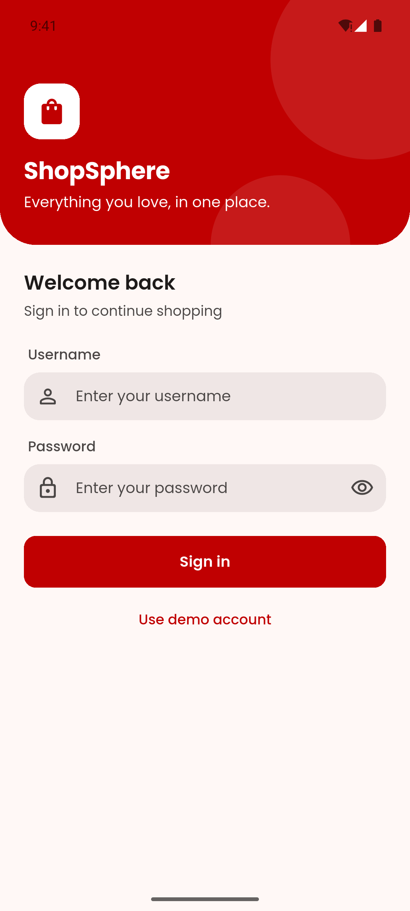 | 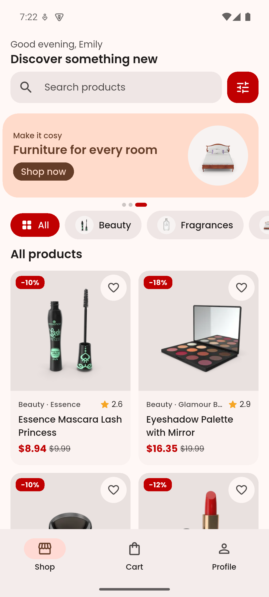 | 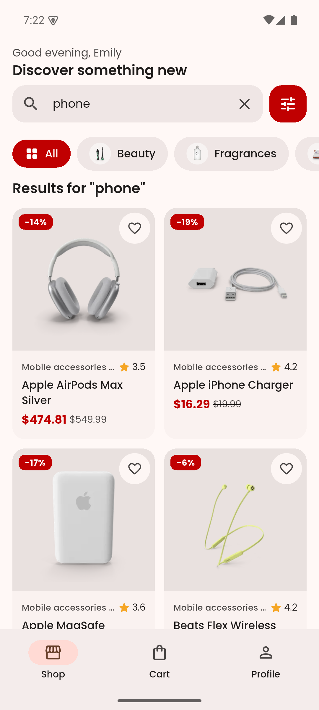 | 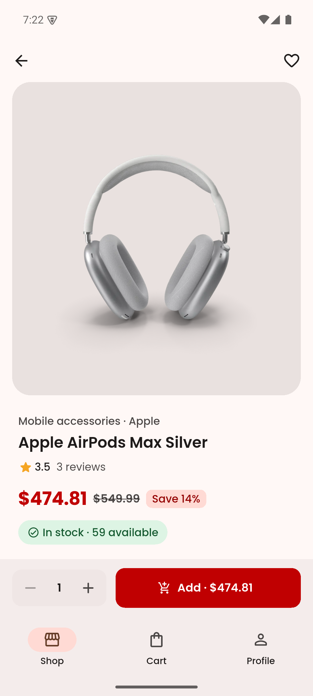 |

| Cart | Order placed | Profile | Offline |
|---|---|---|---|
| 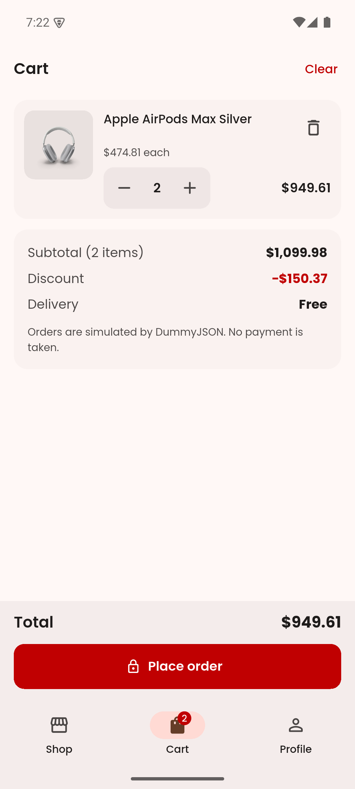 | 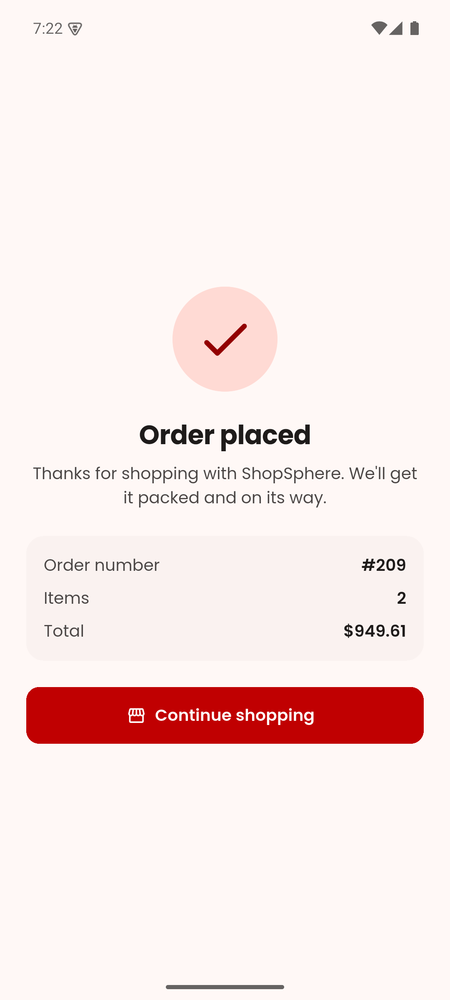 | 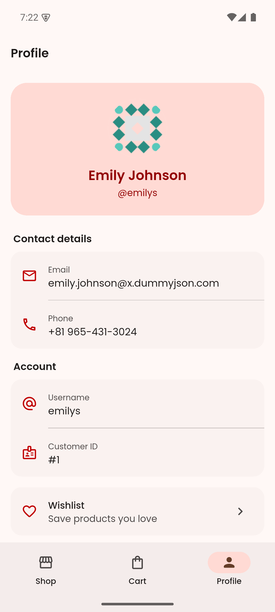 | 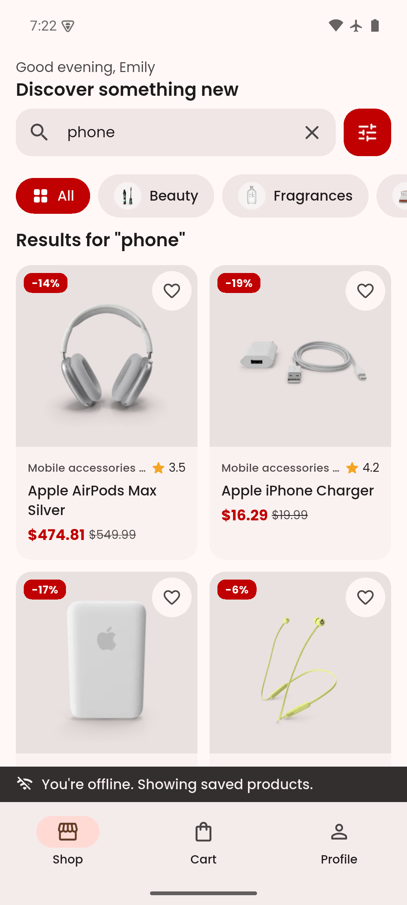 |

| Tablet landscape: master–detail | Phone landscape: navigation rail |
|---|---|
| 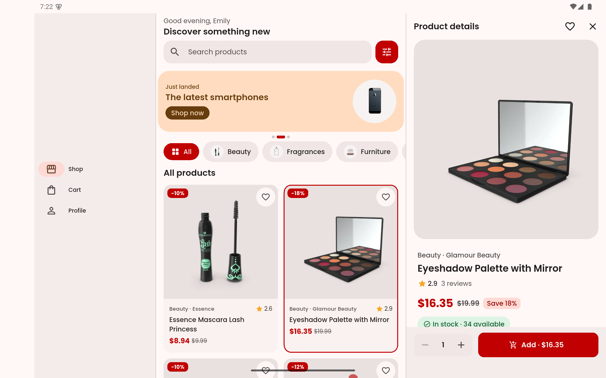 | 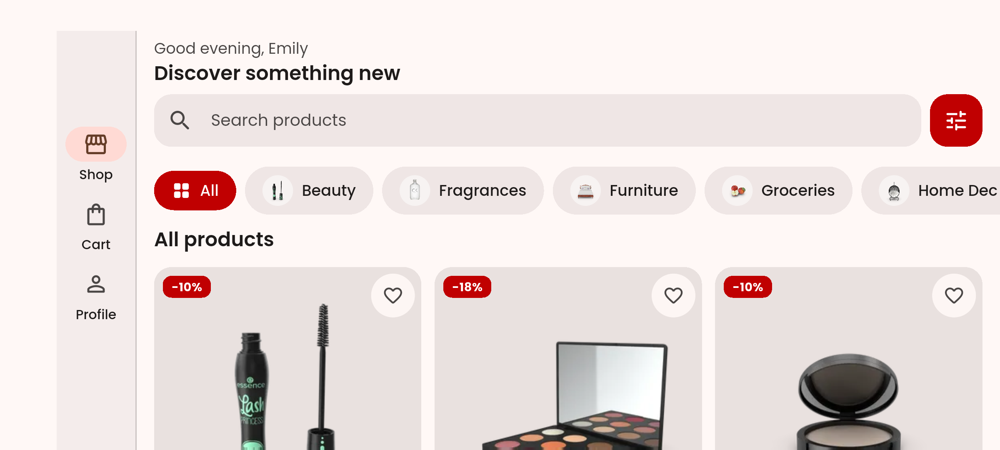 |

---

## 2. Features

### Mandatory

- [x] **Splash** checks the stored session and routes to Home or Login
- [x] **Login** with inline validation (required, minimum length), password visibility toggle and a loading button
- [x] `POST /auth/login`; access and refresh tokens stored in `flutter_secure_storage`
- [x] Clear message for invalid credentials (HTTP 400 → "Invalid username or password.")
- [x] **Responsive product grid** with thumbnail, title, price, discount and rating
- [x] **Infinite scroll** with `limit`/`skip` (page size 20), footer loader, stops at the end
- [x] **Pull-to-refresh**
- [x] **Category chips** loaded from the API
- [x] **Search** with a 400 ms debounce using `/products/search`
- [x] **Sort** by price (low→high, high→low), rating and title
- [x] **Shimmer skeletons** on first load, dedicated **empty state** for "no results"
- [x] **Product details**: image carousel with page indicator, title, brand (null-safe), price with discount, rating, stock status, description, customer reviews
- [x] **Add to cart** with a quantity selector, disabled when out of stock
- [x] **Not-found** state for `/products/9999` (HTTP 404) with a way back
- [x] **Cart**: add, remove (swipe or button, with Undo) and update quantity; subtotal, discount and total
- [x] Cart **persisted locally** with Hive, restored on launch
- [x] **Live cart badge** on the navigation bar and rail
- [x] **Place order** via `POST /carts/add`, success screen, cart cleared
- [x] **Profile** from `GET /auth/me`: avatar, name, email, phone
- [x] **Logout** clears tokens and local session, returns to Login
- [x] **401 / failed refresh (403)** signs the user out with an explanatory message
- [x] **Responsive layouts**: compact (2-column grid, bottom bar), medium (3–4 columns, navigation rail), expanded (master–detail)

### Bonus

- [x] **Automatic token refresh** through a `QueuedInterceptor`, then retries the original request
- [x] **Hero animation** from the list thumbnail to the details image
- [x] **Light / dark / system theme** toggle that persists
- [x] **Offline mode**: last product list and categories cached; "You're offline" banner; refreshes itself when the connection returns
- [x] **Widget tests**, including overflow checks at 1.3× text scale and a tablet master–detail test
- [x] **CI** with GitHub Actions: format check, `flutter analyze`, `flutter test --coverage`
- [ ] Wishlist — not built (see *Assumptions & trade-offs*)
- [ ] Localization (English + Hindi) — not built

### Extra polish

- Stock-aware cart: the details page knows what's already in your cart ("2 in your cart · 3 more available") and never lets you exceed stock
- Personalised greeting, promo carousel that filters by category, category icons, section titles that follow the current filter
- Reduced-motion aware: entrance animations, carousel auto-advance and badge bounce switch off when the OS asks
- Every icon button has a tooltip / semantic label; tap targets are at least 48 dp

---

## 3. Tech stack

| | Version / package | Why |
|---|---|---|
| Flutter | **3.44.2** (stable) | Latest stable at the start of the assignment |
| Dart | **3.12.2** | Sealed classes and pattern matching for `Result`/`Failure` |
| State | `flutter_bloc`, `bloc_concurrency`, `stream_transform`, `equatable` | Explicit events/states, event transformers for debounce/restartable/droppable, value equality for states |
| DI | `get_it` | Simple service locator; the composition root wires everything and widgets never build their own dependencies |
| Networking | `dio`, `pretty_dio_logger` | Interceptors (auth + refresh), timeouts, typed errors; logging only in debug builds |
| Models | `freezed`, `json_serializable` | Immutable DTOs with generated `fromJson`/`toJson` |
| Routing | `go_router` | Declarative routes, auth redirects, `StatefulShellRoute` that keeps each tab's state |
| Secure storage | `flutter_secure_storage` | Tokens in the Android Keystore / iOS Keychain |
| Local storage | `hive_ce`, `hive_ce_flutter` | Cart, product cache and settings; fast and dependency-light (maintained fork of Hive) |
| Images | `cached_network_image`, `shimmer` | Cached photos with placeholders and skeletons |
| UI | `smooth_page_indicator`, Plus Jakarta Sans (bundled, OFL) | Carousel dots; a distinctive typeface without runtime font downloads |
| Connectivity | `connectivity_plus` | Offline banner and automatic refresh |
| Testing | `flutter_test`, `bloc_test`, `mocktail` | State-sequence tests and mocks without code generation |
| Lints | `very_good_analysis` | Strict lint set; `flutter analyze` reports zero issues |

---

## 4. Architecture

Feature-first, with each feature split into **presentation → domain ← data**.
The domain layer is pure Dart (no Flutter, Dio or Hive imports) and owns the
entities, repository interfaces and use cases. The data layer implements the
interfaces; the presentation layer only talks to use cases.

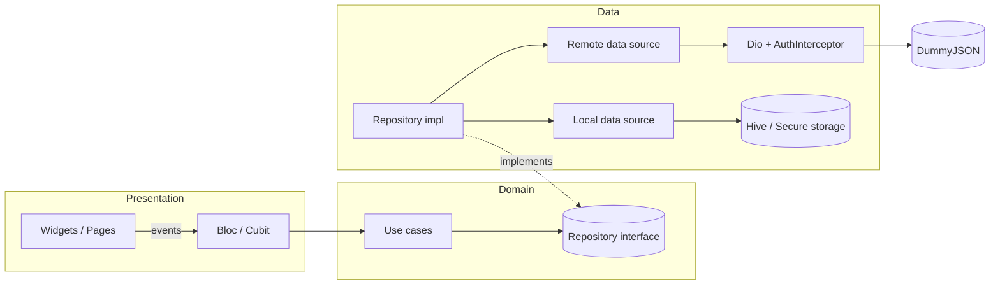

### Folder structure

```
lib/
  app.dart                 # MaterialApp.router, app-wide providers, auth side-effects
  main.dart                # composition root start-up
  core/
    di/                    # get_it registrations
    error/                 # exceptions, failures, Result<T>, mapper
    network/               # Dio client, endpoints, auth interceptor, connectivity
    router/                # go_router config, route paths
    storage/               # token storage, settings storage
    theme/                 # Material 3 theme, colours, spacing, theme cubit
    utils/                 # breakpoints, formatters, validators, debounce transformer
    widgets/               # shared UI: ErrorView, EmptyView, shimmer, shell, banners…
  features/
    auth/      data · domain · presentation
    products/  data · domain · presentation
    cart/      data · domain · presentation
    profile/   presentation   (reuses the auth domain's GetCurrentUser)
test/
  fixtures/                # real DummyJSON responses
  core/ features/          # mirrors lib/
```

### One request, end to end (search)

1. The user types in the search field → `ProductSearchChanged('phone')` is added to `ProductListBloc`.
2. The bloc's `debounceRestartable` transformer waits 400 ms of silence and cancels any older in-flight search.
3. The bloc emits `loading` and calls the `GetProducts` use case with `ProductQuery(search: 'phone')`.
4. `ProductRepositoryImpl` asks `ProductRemoteDataSource`, which calls `GET /products/search?q=phone&limit=20&skip=0&select=…` through Dio.
5. JSON → `ProductPageModel` (freezed) → `ProductPage` entity. Any `DioException` is mapped to a typed `AppException`, then to a `Failure`.
6. The repository returns `Success(page)` or `Err(failure)`; the bloc emits `success`, `empty` or `failure`.
7. The grid rebuilds from the new state. A generation counter drops responses that belong to an older query, so a slow request can never overwrite newer results.

---

## 5. State management

**flutter_bloc** (Bloc for the event-heavy product list, Cubit elsewhere).
Explicit events and states make every screen's behaviour predictable and easy
to test with `bloc_test`, and event transformers handle debounce, restartable
search and droppable pagination declaratively. The trade-off is more
boilerplate than Riverpod or Provider; for a reviewed codebase with many async
edge cases, that explicitness is worth it.

App-wide: `AuthBloc` (session), `CartCubit`, `ProfileCubit`, `ThemeCubit`,
`ConnectivityCubit`. Screen-scoped: `ProductListBloc`, `CategoriesCubit`,
`ProductDetailsCubit`, `LoginCubit`. States are modelled explicitly
(`initial / loading / success / empty / failure`, plus `isLoadingMore`,
`isRefreshing` and one-shot error fields).

---

## 6. Error handling

```
DioException ──mapDioException──▶ AppException ──mapToFailure──▶ Failure ──▶ UI
```

| Low-level | AppException | Failure shown to the user |
|---|---|---|
| connect/send/receive timeout | `RequestTimeoutException` | "The request took too long. Please try again." |
| no connection, `SocketException` | `NetworkException` | "No internet connection. Check your network and retry." |
| 400 | `BadRequestException` | API message, or "Invalid username or password." on login |
| 401 / 403 | `UnauthorizedException` | "Your session has expired. Please log in again." |
| 404 | `NotFoundException` | "We couldn't find what you were looking for." |
| 5xx / other | `ServerException` | "Something went wrong on our side. Please try again." |
| bad JSON shape | `ParseException` / `FormatException` | "We received an unexpected response…" |
| Hive / secure storage | `CacheException` | "Could not access saved data on this device." |

- Repositories never throw: they return `Result<T>` (`Success` / `Err`), a Dart 3 sealed class, so the compiler forces every caller to handle failure.
- Every network screen has **loading, success, empty and error** UI with a Retry action. Pagination errors show inline in the footer and keep loaded items; refresh errors show a snackbar over the existing list.
- `AuthInterceptor` (a `QueuedInterceptor`) attaches the Bearer token, refreshes once on 401 (concurrent 401s wait for a single refresh) and retries. If the refresh token is rejected it clears the session and `AuthBloc` signs the user out with a message. Offline during a refresh keeps the session.
- Offline: the unfiltered first page and categories are cached; a network failure there returns the cached copy (marked as cached), while server errors are never hidden behind the cache.

**Demonstrable error scenarios:** `GET /http/500` (server error view with Retry), `/products/9999` (not found), `/products?delay=3000` (loader stays, timeouts handled), airplane mode (offline banner + cached list), wrong password (inline message).

---

## 7. Getting started

**Prerequisites:** Flutter 3.44.2 (stable), Android SDK, a device or emulator running Android 8.0 (API 26) or later.

```bash
git clone https://github.com/Harsh202458/prosessed-flutter-assignment.git
cd prosessed-flutter-assignment
flutter pub get
flutter run
```

Generated `*.freezed.dart` / `*.g.dart` files are committed, so the app runs
straight after `pub get`. After changing a model, regenerate them:

```bash
dart run build_runner build --delete-conflicting-outputs
```

Build the release APK:

```bash
flutter build apk --release
```

---

## 8. Testing

```bash
flutter test --coverage
```

- **119 tests**, all passing: repositories (success, server-failure and network-failure paths), use cases, every Bloc/Cubit state sequence (`bloc_test`), JSON parsing with real fixtures, and widget tests (validation, not-found, out-of-stock, cart totals, profile, overflow at 1.3× text, tablet master–detail).
- **Line coverage: 75.4%** of hand-written code (generated `*.g.dart` / `*.freezed.dart` excluded; `coverage/lcov.info`).
- CI runs format check, analyze and tests on every push (`.github/workflows/ci.yml`).

---

## 9. Test credentials

| Username | Password |
|---|---|
| `emilys` | `emilyspass` |

Any user from `GET https://dummyjson.com/users` can also sign in.

---

## 10. Assumptions and trade-offs

- **Search vs. category:** DummyJSON can't combine `/products/search` with a category, so a search clears the category and picking a category clears the search. The UI always shows which one is active.
- **Totals are calculated in the app.** DummyJSON rounds `discountedTotal` to whole dollars, so the cart and the confirmation show the same locally computed numbers. The API's order id is shown as the order number (it's simulated and always similar).
- **Orders are simulated.** Nothing is stored server-side; the summary says so.
- **Signing out clears the cart** as part of "clears the local session".
- **Only the unfiltered first page is cached** for offline use, keeping the cache small and predictable.
- **Release signing:** the APK is signed with the debug key so it installs anywhere; a real release would use an upload keystore kept out of the repo.
- **Not done:** wishlist and Hindi localization (bonus). With more time I would add them, golden tests, an integration test that drives login → order, and a real launcher icon/splash via `flutter_native_splash`.

---

## 11. How I used AI tools

I used Claude (Anthropic) as a pair programmer: to plan the phases, scaffold
code, write tests and review edge cases. I tested every build on a real
Android phone, reported bugs I found while using it (for example, the order
confirmation living inside the Cart tab, snackbars that never dismissed, and
being able to add more than the available stock), and had them fixed with
regression tests. I've read and understand every line and can walk through
any part of the code.

---

## 12. Author

- **GitHub:** [Harsh202458](https://github.com/Harsh202458)
- **Name:** Harsh

Fonts: Plus Jakarta Sans © The Plus Jakarta Sans Project Authors, SIL Open Font License 1.1 (`assets/fonts/OFL.txt`).
